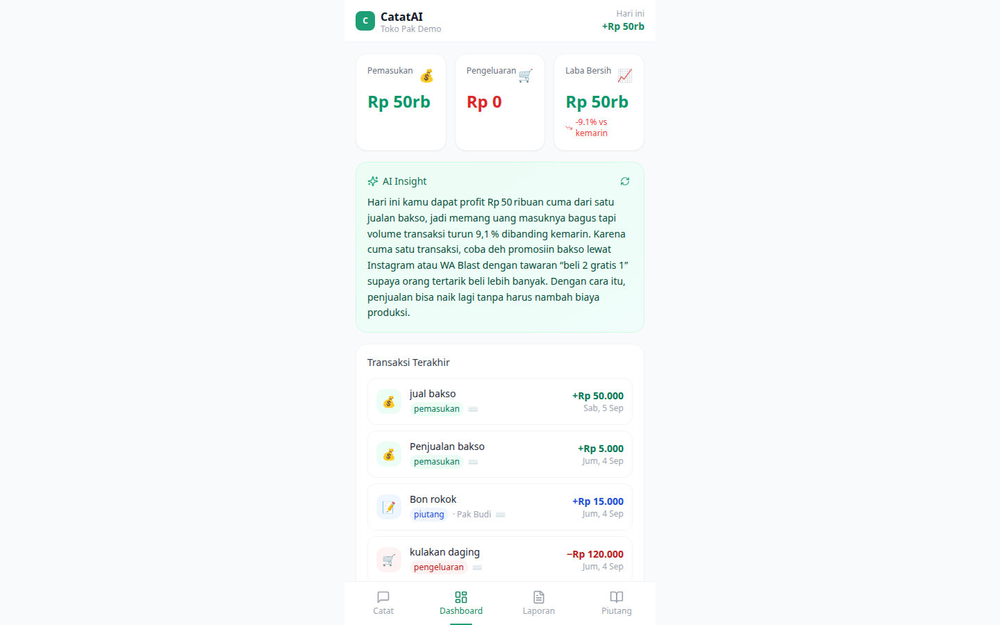
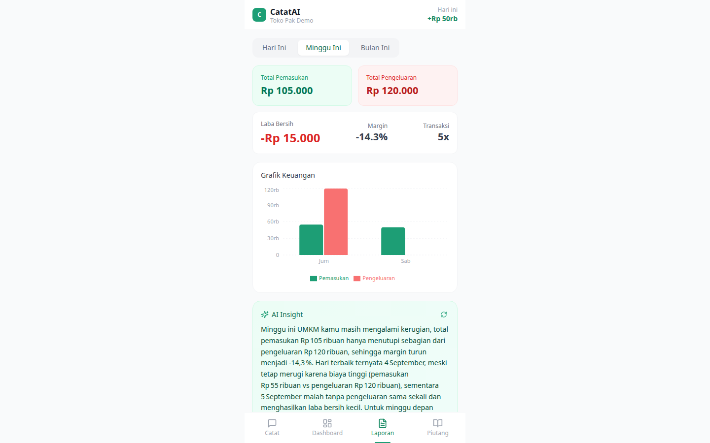
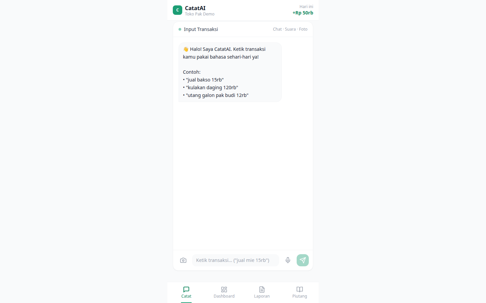

# CatatAI — AI Financial Assistant untuk UMKM

> AI yang ngerti bahasa warung: "utang galon", "kulakan", "bon", "bayar separo"

[](https://catat-ai-azhars-projects-da34b643.vercel.app)
[](https://catat-ai-api-azhars-projects-da34b643.vercel.app/health)
[](https://nextjs.org)
[](https://fastapi.tiangolo.com)
[](LICENSE)

**CatatAI** membantu pedagang kecil mencatat keuangan tanpa ribet — cukup ketik, bicara, atau foto struk dalam bahasa sehari-hari. AI mengubahnya jadi catatan transaksi yang rapi, lengkap dengan dashboard, laporan, dan insight otomatis.

| Live | URL |
|---|---|
| 🌐 Aplikasi | https://catat-ai-azhars-projects-da34b643.vercel.app |
| ⚙️ API | https://catat-ai-api-azhars-projects-da34b643.vercel.app |
| 🩺 Health check | https://catat-ai-api-azhars-projects-da34b643.vercel.app/health |

## 📸 Screenshot

| Dashboard — metrik + AI insight | Laporan — grafik mingguan |
|---|---|
|  |  |

| Catat — input bahasa sehari-hari |
|---|
|  |

---

## ✨ Fitur

- 💬 **Input via chat** — ketik "jual bakso 50rb", AI langsung mencatatnya sebagai pemasukan
- 🎤 **Input via suara** — rekam bicara, di-transcribe Whisper lalu di-parse AI
- 📸 **Scan struk** — foto struk belanja, dibaca AI multimodal lalu dicatat otomatis
- 📊 **Dashboard** — grafik pemasukan/pengeluaran harian, metrik laba bersih
- 📈 **Laporan** — harian, mingguan, dan bulanan
- 🧠 **AI insight** — narasi keuangan otomatis dengan bahasa santai
- 🧾 **Manajemen piutang** — catat "bon", lacak piutang aktif, proses pelunasan

### Contoh input yang dipahami

| Input kamu | Yang tercatat |
|---|---|
| "jual bakso 50rb" | Pemasukan Rp50.000 |
| "kulakan minyak 75 ribu" | Pengeluaran Rp75.000 |
| "bon budi 50rb, udah bayar 20rb" | Piutang Rp50.000, sudah dibayar Rp20.000 |
| "bayar separo utang galon" | Pelunasan sebagian piutang |

## 🛠 Tech Stack

| Layer | Teknologi |
|-------|-----------|
| Frontend | Next.js 14 (App Router), React 18, Tailwind CSS, Recharts |
| Backend | FastAPI (Python 3.11–3.14), Vercel Serverless Functions |
| AI | Groq — GPT-OSS 120B (parse & insight), Whisper large v3 (speech-to-text), Qwen 3.8 multimodal (scan struk) |
| Database | Supabase (PostgreSQL) |

> Semua fitur AI jalan lewat **satu API key Groq gratis** — daftar di https://console.groq.com/keys

## 📁 Struktur Proyek

```
catat-ai/
├── setup.sh                  # Setup otomatis pertama kali
├── run.sh                    # Jalankan backend + frontend sekaligus
├── backend/                  # FastAPI Python
│   ├── app/
│   │   ├── api/              # Route endpoints
│   │   ├── core/             # Config, database, Groq client
│   │   ├── models/           # Pydantic models
│   │   ├── services/         # Business logic (AI, transaksi, speech)
│   │   └── prompts/          # AI prompt templates
│   ├── api/index.py          # Entry point Vercel (serverless)
│   ├── vercel.json           # Konfigurasi deploy Vercel
│   ├── seed.py               # Insert user demo ke Supabase
│   ├── .env.example          # Template environment variables
│   └── requirements.txt
├── frontend/                 # Next.js React
│   ├── app/
│   │   ├── components/       # UI components
│   │   ├── hooks/            # Custom React hooks
│   │   └── lib/              # API client, utils
│   ├── .env.local.example    # Template environment variables
│   └── package.json
├── supabase/
│   ├── schema.sql            # Database schema
│   └── seed-demo.sql         # Data contoh
└── docs/
    ├── SETUP.md              # Panduan instalasi detail
    ├── STRUCTURE.md          # Struktur + daftar API endpoint
    └── screenshots/          # Screenshot aplikasi
```

## 📋 Prasyarat

- **Python** 3.11 – 3.14
- **Node.js** 18+ dan npm
- **Akun Groq** (gratis) → [console.groq.com/keys](https://console.groq.com/keys)
- **Akun Supabase** (gratis) → [supabase.com](https://supabase.com)

## 🚀 Quick Start

**Cara cepat** (macOS/Linux):

```bash
git clone https://github.com/azharzuhro12/catat-ai.git
cd catat-ai
bash setup.sh        # setup venv + install dependencies
```

**Langkah manual:**

1. **Siapkan database** — buat project Supabase, jalankan `supabase/schema.sql` di SQL Editor
2. **Isi environment variables** — copy `.env.example` → `.env` (backend) dan `.env.local.example` → `.env.local` (frontend), lihat [Environment Variables](#-environment-variables)
3. **Seed user demo** — `cd backend && python seed.py`
4. **Jalankan semuanya** — `bash run.sh` (backend di `:8002`, frontend di `:3000`)
5. **Buka** — http://localhost:3000 · API docs: http://localhost:8002/docs

Panduan lengkap per sistem operasi: [`docs/SETUP.md`](docs/SETUP.md)

## 🔑 Environment Variables

**`backend/.env`**

| Variabel | Wajib | Keterangan |
|----------|:-----:|------------|
| `GROQ_API_KEY` | ✅ | API key Groq untuk semua fitur AI |
| `SUPABASE_URL` | ✅ | Project URL Supabase |
| `SUPABASE_KEY` | ✅ | Anon key (publishable) Supabase |
| `SUPABASE_SERVICE_KEY` | ✅ | Service role key (server-side saja) |
| `SECRET_KEY` | ✅ | Secret acak untuk produksi |
| `ENVIRONMENT` | — | `development` / `production` |

**`frontend/.env.local`**

| Variabel | Wajib | Keterangan |
|----------|:-----:|------------|
| `NEXT_PUBLIC_API_URL` | ✅ | Base URL backend, mis. `http://localhost:8002/api/v1` |
| `NEXT_PUBLIC_SUPABASE_URL` | ✅ | Project URL Supabase |
| `NEXT_PUBLIC_SUPABASE_ANON_KEY` | ✅ | Anon key (publishable) Supabase |

## 🌐 API Endpoints

Base URL: `/api/v1` — dokumentasi interaktif tersedia di `/docs` (Swagger UI).

| Method | Endpoint | Fungsi |
|--------|----------|--------|
| POST | `/transaksi/chat` | Input transaksi via teks bebas |
| POST | `/transaksi/suara` | Input via rekaman audio |
| POST | `/transaksi/scan-struk` | Input via foto struk |
| GET | `/transaksi/list` | Daftar transaksi |
| GET | `/transaksi/ringkasan-harian` | Ringkasan harian + AI insight |
| GET | `/transaksi/laporan?periode=mingguan` | Laporan periodik (`harian`/`mingguan`/`bulanan`) |
| GET | `/transaksi/piutang` | Daftar piutang aktif |
| POST | `/transaksi/piutang/bayar` | Proses pembayaran piutang |
| GET | `/health` | Status API |

Contoh:

```bash
curl -X POST https://catat-ai-api-azhars-projects-da34b643.vercel.app/api/v1/transaksi/chat \
  -H "Content-Type: application/json" \
  -d '{"teks": "jual bakso 50rb", "user_id": "00000000-0000-0000-0000-000000000001"}'
```

## ☁️ Deployment (Vercel)

Backend dan frontend masing-masing deploy sebagai project Vercel terpisah:

```bash
# Backend → project "catat-ai-api"
cd backend
npx vercel link --project catat-ai-api
npx vercel env add GROQ_API_KEY production   # ulangi untuk semua env var
npx vercel deploy --prod

# Frontend → project "catat-ai"
cd ../frontend
npx vercel link --project catat-ai
npx vercel env add NEXT_PUBLIC_API_URL production  # dst.
npx vercel deploy --prod
```

> ⚠️ Matikan **Deployment Protection** (SSO) di kedua project agar aplikasi bisa diakses publik:
> `npx vercel project protection disable <nama-project> --sso`

## 🗺 Roadmap

- [ ] Autentikasi multi-user (Supabase Auth)
- [ ] Ekspor laporan PDF/Excel
- [ ] PWA — bisa dipakai offline di HP
- [ ] Reminder piutang jatuh tempo

## 📚 Dokumentasi Lanjutan

- [`docs/SETUP.md`](docs/SETUP.md) — panduan instalasi lengkap per-OS
- [`docs/STRUCTURE.md`](docs/STRUCTURE.md) — struktur folder detail + checklist demo
- [`supabase/schema.sql`](supabase/schema.sql) — skema database
